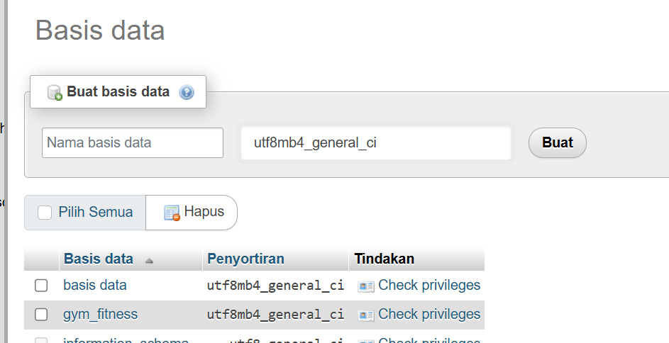
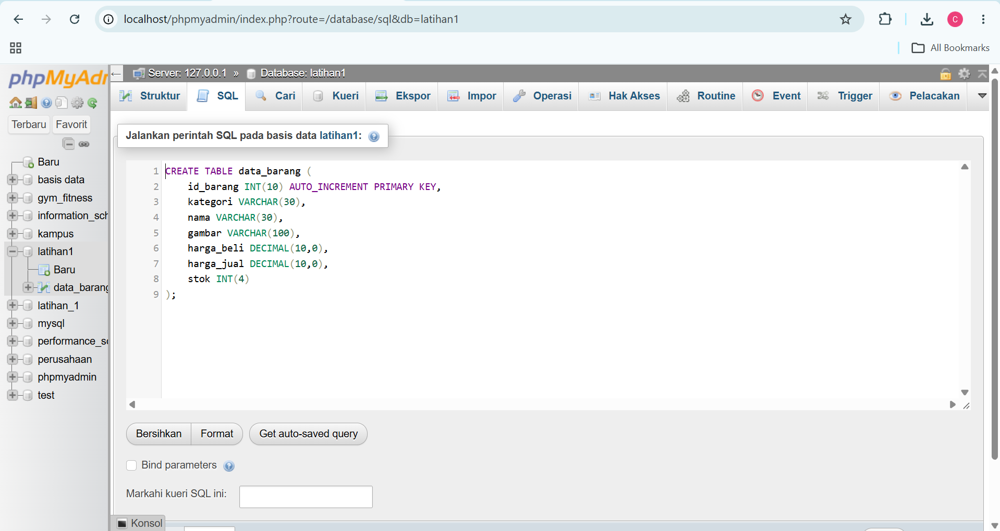
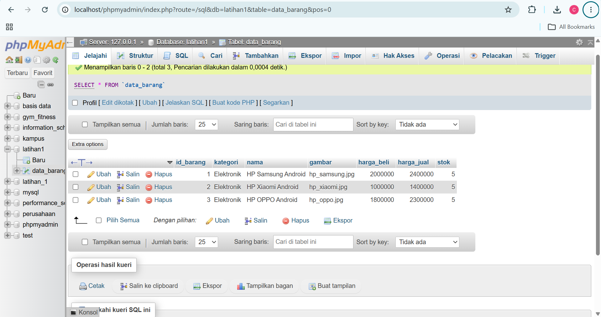
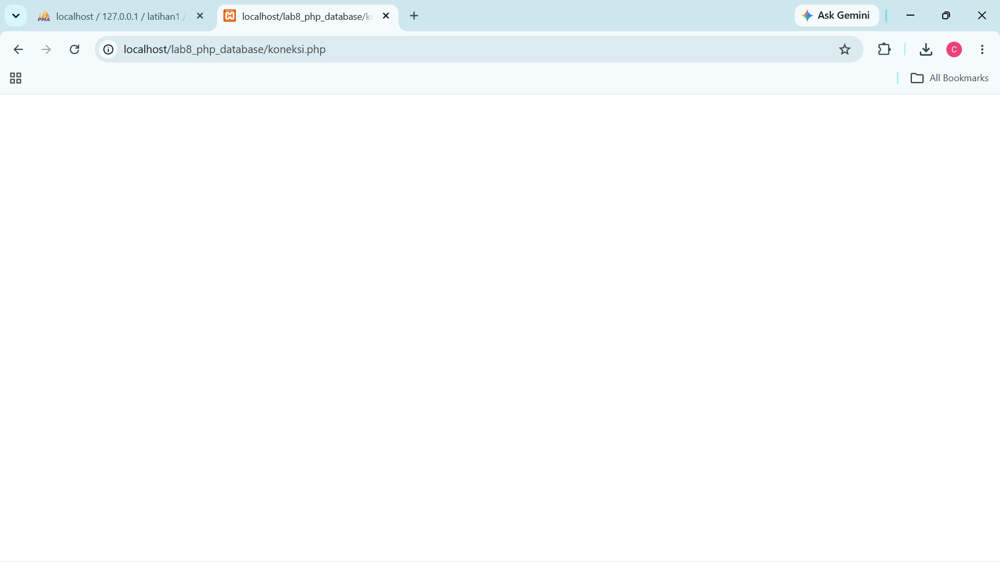
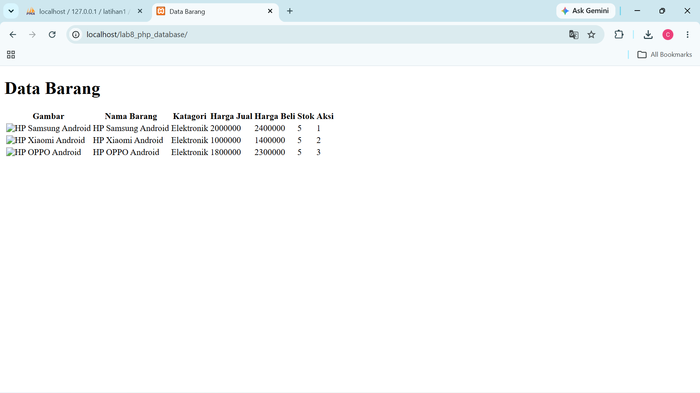
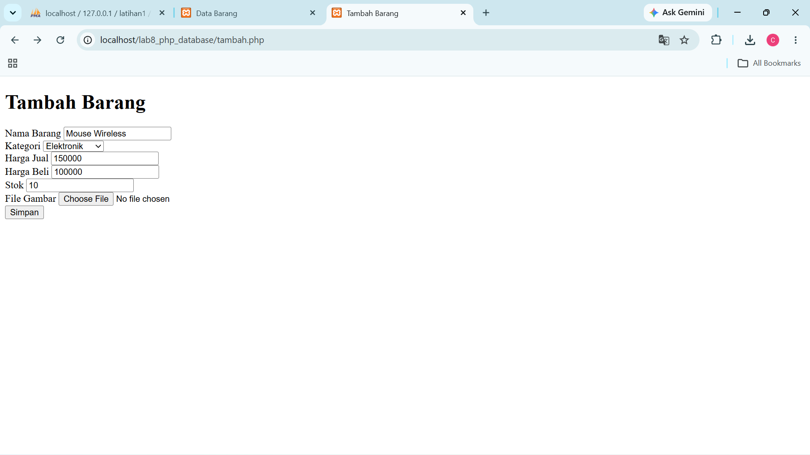
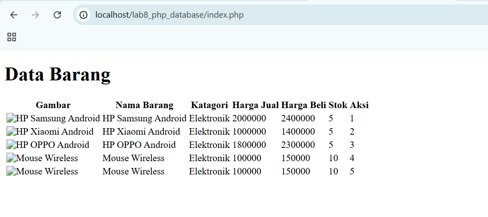
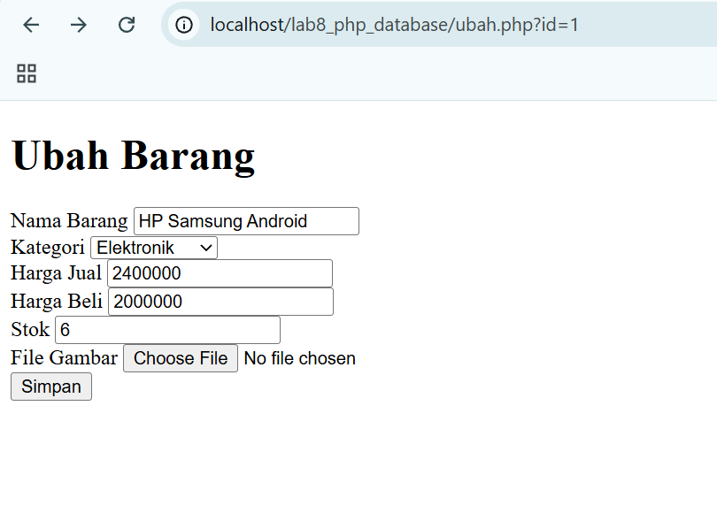
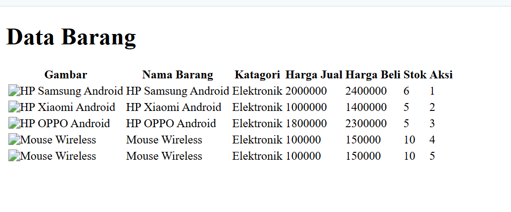

# Lab8Web - Praktikum 8: PHP dan Database MySQL

**Nama** : Chelsea Meynita Vadlistya
**Program Studi** : Teknik Informatika
**Mata Kuliah** : Pemrograman Web OBE
**NIM / Kelas** : _(isi NIM dan kelas)_

---

## Tujuan Praktikum

1. Mahasiswa mampu memahami konsep dasar database.
2. Mahasiswa mampu memahami konsep dasar CRUD menggunakan PHP.
3. Mahasiswa mampu membuat program CRUD sederhana menggunakan PHP.

## Perangkat yang Digunakan

- Text editor: Visual Studio Code
- Web server & database: XAMPP (Apache, MySQL/MariaDB)
- Browser: Google Chrome
- Klien database: phpMyAdmin (`http://localhost/phpmyadmin/`)

## Struktur Folder

```
Lab8Web/
├── README.md
├── database.sql              # script database, tabel, dan data awal
├── screenshots/              # screenshot hasil praktikum
└── lab8_php_database/        # disalin ke C:\xampp\htdocs\
    ├── koneksi.php           # koneksi ke database
    ├── index.php             # Read   - menampilkan data
    ├── tambah.php            # Create - menambah data
    ├── ubah.php              # Update - mengubah data
    ├── hapus.php             # Delete - menghapus data
    ├── style.css             # tampilan
    └── gambar/               # tempat file gambar barang
```

## Cara Menjalankan

1. Salin folder `lab8_php_database` ke `htdocs` XAMPP.
2. Jalankan **Apache** dan **MySQL** dari XAMPP Control Panel.
3. Buka phpMyAdmin, lalu jalankan isi `database.sql` pada tab SQL.
4. Buka `http://localhost/lab8_php_database/` di browser.

---

## Langkah-langkah Praktikum

### 1. Persiapan: Menjalankan Apache dan MySQL

Membuat folder `lab8_php_database` di dalam `htdocs`, lalu menjalankan modul **Apache** dan **MySQL** pada XAMPP Control Panel. MySQL dibutuhkan sebagai database server, Apache sebagai web server untuk menjalankan PHP.


### 2. Membuat Database dan Tabel

Membuka `http://localhost/phpmyadmin/`, lalu membuat database `latihan1` melalui menu **Basis data**, dan membuat tabel `data_barang` melalui tab SQL.



```sql
CREATE DATABASE latihan1;

CREATE TABLE data_barang (
  id_barang int(10) auto_increment Primary Key,
  kategori varchar(30),
  nama varchar(30),
  gambar varchar(100),
  harga_beli decimal(10,0),
  harga_jual decimal(10,0),
  stok int(4)
);
```

| Nama Field | Tipe Data | Ukuran | Keterangan |
|---|---|---|---|
| id_barang | INT | 10 | Primary Key, Auto Increment |
| kategori | VARCHAR | 30 | |
| nama | VARCHAR | 30 | |
| gambar | VARCHAR | 100 | |
| harga_beli | DECIMAL | 10 | |
| harga_jual | DECIMAL | 10 | |
| stok | INT | 4 | |



### 3. Menambahkan Data Awal

Mengisi tabel dengan tiga data barang menggunakan perintah `INSERT`.

```sql
INSERT INTO data_barang (kategori, nama, gambar, harga_beli, harga_jual, stok)
VALUES ('Elektronik', 'HP Samsung Android', 'hp_samsung.jpg', 2000000, 2400000, 5),
('Elektronik', 'HP Xiaomi Android', 'hp_xiaomi.jpg', 1000000, 1400000, 5),
('Elektronik', 'HP OPPO Android', 'hp_oppo.jpg', 1800000, 2300000, 5);
```



### 4. Membuat File Koneksi Database (`koneksi.php`)

File ini menyimpan konfigurasi host, user, password, dan nama database, lalu membuat koneksi dengan `mysqli_connect()`. Jika koneksi gagal, program menampilkan pesan error dan berhenti (`die()`). File ini di-*include* oleh semua file CRUD lainnya.

```php
<?php
$host = "localhost";
$user = "root";
$pass = "";
$db   = "latihan1";

$conn = mysqli_connect($host, $user, $pass, $db);
if ($conn == false)
{
    echo "Koneksi ke server gagal.";
    die();
} #else echo "Koneksi berhasil";
?>
```

Saat `koneksi.php` dibuka di browser, halaman tampil kosong karena perintah `echo "Koneksi berhasil";` masih dikomentari. Halaman kosong tanpa pesan "Koneksi ke server gagal." berarti koneksi ke database berhasil.



### 5. Menampilkan Data / Read (`index.php`)

`index.php` meng-*include* `koneksi.php`, menjalankan query `SELECT * FROM data_barang`, lalu menampilkan setiap baris hasilnya ke dalam tabel HTML dengan perulangan `while` dan `mysqli_fetch_array()`. Kolom **Aksi** berisi link **Ubah** dan **Hapus** yang membawa `id_barang`, serta ada link **Tambah Barang** di atas tabel.

Tampilan awal sesuai kode modul. Pada tahap ini terlihat beberapa hal yang perlu diperbaiki: gambar belum tampil, nilai Harga Jual dan Harga Beli tertukar, dan kolom Aksi baru berisi ID (perbaikannya dijelaskan di bagian *Perbaikan dari Kode Modul*).



### 6. Menambah Data / Create (`tambah.php`)

Form berisi nama, kategori, harga jual, harga beli, stok, dan file gambar (`enctype="multipart/form-data"` agar file dapat diunggah). Saat tombol **Simpan** ditekan, data dari `$_POST` dan file dari `$_FILES` diproses: gambar dipindahkan ke folder `gambar/` dengan `move_uploaded_file()`, lalu data disimpan dengan query `INSERT INTO`. Setelah itu halaman diarahkan kembali ke `index.php`.





### 7. Mengubah Data / Update (`ubah.php`)

Halaman menerima `id` lewat URL (`ubah.php?id=1`), mengambil data barang tersebut dengan `SELECT ... WHERE id_barang`, dan menampilkannya di form. Fungsi `is_select()` dipakai untuk menandai kategori yang sedang terpilih. Saat disimpan, query `UPDATE` dijalankan; kolom gambar hanya diperbarui bila ada file baru yang diunggah. `id` dikirim lewat input `hidden`.





### 8. Menghapus Data / Delete (`hapus.php`)

`hapus.php` mengambil `id` dari URL, menjalankan query `DELETE FROM data_barang WHERE id_barang = ...`, lalu kembali ke `index.php`. Pada `index.php`, link Hapus diberi konfirmasi `confirm()` agar data tidak terhapus tanpa sengaja.

```php
<?php
include_once 'koneksi.php';
$id = $_GET['id'];
$sql = "DELETE FROM data_barang WHERE id_barang = '{$id}'";
$result = mysqli_query($conn, $sql);
header('location: index.php');
?>
```


---

## Perbaikan dari Kode Modul

Beberapa bagian kode pada modul diperbaiki agar program berjalan benar:

| File | Masalah pada modul | Perbaikan |
|---|---|---|
| `index.php` | Isi kolom Harga Jual dan Harga Beli tertukar dengan headernya | Urutan `harga_jual` lalu `harga_beli` disesuaikan dengan header |
| `index.php` | Kolom Aksi hanya menampilkan ID, tidak ada link Ubah/Hapus/Tambah | Ditambahkan link `ubah.php?id=`, `hapus.php?id=`, dan `tambah.php` |
| `index.php` | Path gambar `gambar/` + isi database bisa menjadi `gambar/gambar/...` | Path dicek dulu agar prefix `gambar/` tidak dobel |
| `ubah.php` | `enctype="multipart/formdata"` salah ketik sehingga upload gagal | Diperbaiki menjadi `multipart/form-data` |
| `ubah.php` | `is_select()` selalu membandingkan dengan `'Komputer'` | Masing-masing option dibandingkan dengan value-nya |
| `tambah.php` | Folder `gambar/` harus dibuat manual | Dibuat otomatis jika belum ada |

Tampilan `index.php` setelah perbaikan diterapkan:


## Kesimpulan

Dengan praktikum ini, program CRUD sederhana (Create, Read, Update, Delete) menggunakan PHP dan MySQL berhasil dibuat. PHP terhubung ke database melalui `mysqli_connect()`, dan operasi data dilakukan dengan query `SELECT`, `INSERT`, `UPDATE`, dan `DELETE`.
